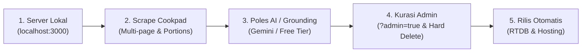
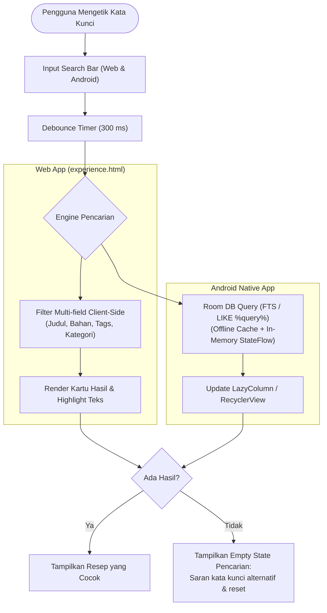
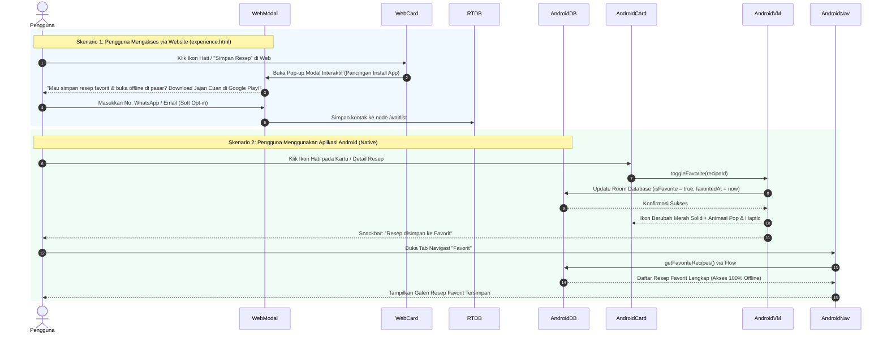
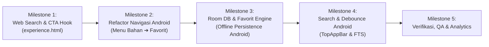

# Product Requirement Document (PRD) & Blueprint Konsep Aplikasi

## Aplikasi Android: Ide Usaha Jajanan Viral

-----

## 1\. Ringkasan Eksekutif & Identitas Produk

  * **Nama Aplikasi:**
      * *Jajan Cuan*
  * **Target Pengguna:** Pemula usaha kuliner rumahan, ibu rumah tangga, dan pelaku UMKM yang mencari ide jualan jajanan viral dengan modal terjangkau serta panduan bisnis praktis.
  * **Value Proposition:** Bukan sekadar buku resep biasa, melainkan *end-to-end business toolkit* yang memandu pengguna mulai dari pemilihan ide jajanan prospektif, panduan masak anti-gagal, kalkulasi modal dan harga jual otomatis, hingga penyediaan aset foto promosi siap pakai.

-----

## 2\. Arsitektur Sistem & Backend (Firebase)

Aplikasi memanfaatkan infrastruktur cloud Firebase untuk kemudahan operasional dan skalabilitas:

| Layanan Firebase                  | Fungsi Spesifik                                                                                                            |
| :-------------------------------- | :------------------------------------------------------------------------------------------------------------------------- |
| **Firebase Remote Config**        | Mengelola parameter aplikasi secara dinamis tanpa update APK (misal: ID unit iklan, resep unggulan mingguan, pengumuman).  |
| **Cloud Firestore / Realtime DB** | Menyimpan database terstruktur: katalog resep, kategori bahan, takaran default, dan data acuan HPP.                        |
| **Firebase Storage**              | Media hosting aset visual resolusi tinggi: foto utama resep (hero/commercial photo) dan materi promosi siap unduh. |
| **Firebase Hosting**              | Hosting berbasis CDN global untuk Landing Page & Experience Layer, mendukung SPA rewrite native, multi-site, dan SSL gratis.|
| **Google Analytics for Firebase** | Melacak perilaku pengguna: resep paling sering dibuka, interaksi kalkulator, konversi rewarded ads, dan retensi sesi.      |

-----

## 3\. Fitur Utama & Spesifikasi Fungsional

### A. Katalog Resep Jajan Viral (Main Feature)

  * Menyajikan kurasi resep jajanan yang sedang tren dengan perputaran modal cepat dan potensi pasar tinggi.
  * Setiap resep memiliki data terstruktur: Foto Utama, Analisis Bisnis (Pros), Komposisi Bahan, Cara Memasak, Kalkulator Biaya, dan Konten Promosi.

### B. Kalkulator HPP & Harga Jual Dinamis (On-The-Fly)

  * **Input Fleksibel:**
      * Daftar bahan baku beserta harganya dapat diedit langsung oleh pengguna secara *real-time* sesuai harga pasar di daerah masing-masing.
      * Jumlah porsi/biji (*pieces*) yang dihasilkan dari satu resep (nilai acuan dapat diubah).
      * Target laba yang diharapkan (berupa persentase % atau nominal rupiah per porsi).
  * **Output Otomatis:**
      * Total modal belanja bahan per resep.
      * Harga Pokok Penjualan (HPP) per porsi/biji.
      * Rekomendasi harga jual ideal per porsi/biji agar terhindar dari kerugian.

### C. Timer Notifikasi Memasak (Unlocked via Rewarded Ads)

  * Tombol timer tertanam langsung di setiap instruksi memasak yang membutuhkan penanda waktu (misal: "Kukus adonan selama 15 menit").
  * Pengguna menonton video iklan singkat (*Rewarded Ads*) secara sukarela untuk mengaktifkan fungsi pengingat waktu memasak (*smart kitchen assistant*).
  * Pengguna dapat mengatur label dan durasi waktu memasak.
  * Aplikasi mengirimkan alarm notifikasi lokal (*local push notification*) saat waktu habis sehingga masakan matang sempurna tanpa risiko gosong.

### D. Konten Promosi Siap Pakai (Shareable Assets)

  * Galeri foto jajanan berkualitas tinggi yang sudah ditata menarik (*food styling*) untuk kebutuhan promosi.
  * Fitur interaksi:
      * Tampilan *pop-up viewer* untuk melihat detail gambar.
      * Tombol unduh (*download*) langsung ke galeri ponsel.
      * Tombol berbagi langsung (*one-click share*) ke WhatsApp Status, Instagram Story, Facebook Group, dan media sosial lainnya.

### E. Fitur Pencarian Cerdas (Smart Search Multi-Platform)

  * **Kolom Pencarian Terpadu (Web & Android):** Terletak strategis di bagian atas layar untuk mencari resep secara instan tanpa hambatan.
  * **Multi-Parameter Matching:** Mendukung pencarian berbasis:
      * **Judul Resep:** Misal mencari "pangsit", "cireng", "risol".
      * **Bahan Dasar:** Mengetik sisa bahan baku yang ada di dapur (misal: "tapioka", "kulit lumpia", "keju", "sosis") untuk langsung menemukan ide olahan jualan.
      * **Tag & Kategori:** Mencari berdasarkan kata kunci tren (misal: "modal-kecil", "viral", "tanpa-oven").
  * **Pencarian Realtime & Debounce:** Menampilkan hasil dalam hitungan milidetik dengan *debounce* typing 300ms untuk kenyamanan pengguna tanpa lag.

### F. Fitur Tandai Favorit / Bookmark (Eksklusif Android — Web sebagai Pancingan Install App)

  * **Fitur Eksklusif Aplikasi Android:** Dirancang khusus untuk pengguna mobile native agar daftar resep tersimpan aman di database lokal perangkat (*Room Database*), tidak hilang saat *clear browser cache*, serta dapat diakses **100% offline** di dapur atau pasar tradisional.
  * **Strategi Web sebagai Pancingan (*Conversion Hook*):** Di website (*experience layer*), fitur favorit sengaja **tidak menyediakan penyimpanan lokal**. Tombol bookmark di web difungsikan sebagai pancingan konversi (*lead generation*): saat pengunjung web mengeklik tombol hati/bookmark, sistem memunculkan pop-up modal interaktif untuk mengarahkan pengunjung mengunduh aplikasi di Google Play (*"Ingin simpan resep favorit tanpa batas & buka offline di pasar? Download aplikasi Jajan Cuan di Google Play!"*).

### G. Kategori & Filter Bahan Terintegrasi

  * Pengelompokan resep berdasarkan bahan utama dan kategori modal kini disajikan melalui *Filter Chips / Tags* interaktif dan kotak pencarian, sehingga tidak memerlukan menu navigasi terpisah.

-----

## 4\. Struktur Halaman Aplikasi (Sitemap)

### A. Halaman Home

  * **Komponen Pencarian:** Search Bar interaktif di header atas untuk penelusuran cepat judul jajanan maupun stok bahan di rumah (berfungsi penuh baik di Web maupun Android).
  * **Komponen Iklan:** Banner Ads di sisi layar dan Native Ads yang disisipkan di sela-sela kartu galeri.
  * **Konten:** Galeri *thumbnail* resep jajan viral terbaru dan terpopuler dengan tombol hati (*bookmark*):
      * Di **Android**: Langsung menyimpan resep ke Room DB lokal dan masuk ke menu tab Favorit.
      * Di **Web**: Bertindak sebagai pancingan konversi yang memicu modal pop-up ajakan instal aplikasi Google Play.

### B. Halaman Detail Resep

  * **Action Bar:** Tombol aksi **Tandai Favorit** (di Android: toggle status bookmark lokal; di Web: memicu modal pancingan unduh aplikasi Android) dan tombol **Share** sosial media.
  * **Foto Utama:** Tampilan visual produk jadi berkualitas tinggi.
  * **Pros (Analisis Bisnis):** Ulasan peluang pasar, tingkat kemudahan bahan dan pembuatan, serta perkiraan modal awal.
  * **Komposisi:** Rincian takaran dan daftar bahan baku.
  * **Cara Memasak (Langsung Terbuka / Tanpa Gating):** Panduan langkah demi langkah berbasis daftar teks (*glanceable list*) yang praktis dibaca saat memasak di dapur tanpa ribet *swipe* atau *buffering* gambar. Dilengkapi tombol pintas ke *Timer Notifikasi*.
  * **Kalkulator (Unlocked via Rewarded Ads):** Alat hitung modal bahan dan penetapan harga jual dinamis.
  * **Konten Promosi (Unlocked via Rewarded Ads):** Galeri foto promosi dengan fungsi *pop-up*, unduh, dan *share*.

### C. Halaman Favorit (Koleksi Resep Tersimpan — Menggantikan Halaman Bahan)

  > [!NOTE]
  > **Perubahan Arsitektur Navigasi Android:** Menu navigasi bawah (*Bottom Navigation Bar*) yang sebelumnya bernama **"Bahan"** kini resmi dialihkan menjadi menu **"Favorit"** guna memaksimalkan retensi pengguna dan kemudahan akses resep yang ingin dieksekusi.

  * **Komponen Iklan:** Banner Ads di sisi layar dan Native Ads di antara kartu resep tersimpan.
  * **Konten:** Galeri kartu resep yang telah ditandai favorit oleh pengguna secara lokal.
  * **Filter & Pencarian Lokal:** Kolom pencarian cepat di dalam daftar favorit untuk memudahkan menemukan resep tersimpan saat koleksi sudah banyak.
  * **Tampilan Empty State:** Saat belum ada resep favorit yang disimpan, menampilkan ilustrasi menarik, motivasi usaha, dan tombol CTA *"Jelajahi Ide Resep Sekarang"* yang mengarahkan pengguna kembali ke Home.
  * **Dukungan Offline:** Seluruh resep di halaman ini dapat dibuka tanpa koneksi internet.

### D. Halaman Settings

  * **Privacy Policy:** Tautan kebijakan privasi yang wajib ada untuk kepatuhan Google Play Store dan jaringan iklan AdMob.
  * **Info Versi:** Keterangan versi build aplikasi dan pembaruan sistem.

-----

## 5\. Alur Pengguna Lengkap (End-to-End User Journey)

### Tahap 1: Eksplorasi & Pencarian Ide Usaha

  * Pengguna membuka aplikasi/web dan mendarat di halaman **Home** untuk melihat galeri jajanan viral yang sedang tren.
  * **Pencarian Cerdas (Web & Android):** Pengguna dapat mengetik kata kunci pada **Search Bar** di bagian atas (misal mencari *"cireng"*, *"modal kecil"*, atau bahan baku yang tersedia di dapur seperti *"kulit lumpia"*, *"tapioka"*).
  * **Tandai Favorit vs Pancingan Install:**
      * **Di Aplikasi Android:** Pengguna mengetuk ikon hati (**Favorit**) pada kartu resep yang diminati untuk menyimpannya ke koleksi resep lokal pribadi.
      * **Di Website:** Mengetuk ikon hati memunculkan modal pancingan *"Download Aplikasi di Google Play"* agar pengguna terdorong mengunduh aplikasi untuk menyimpan resep dan membukanya offline.
  * Pengguna memilih salah satu resep untuk melihat rincian lengkapnya.

### Tahap 2: Validasi Peluang Bisnis

  * Pengguna masuk ke halaman **Detail Resep** dan membaca bagian **Pros (Analisis Bisnis)** untuk memahami potensi keuntungan, daya tarik pembeli, dan ketersediaan bahan di pasaran.
  * Pengguna memeriksa daftar **Komposisi** untuk memastikan bahan-bahannya mudah dijangkau.
  * Di aplikasi Android, pengguna dapat menekan tombol **Favorit** di action bar untuk memastikan resep ini tersimpan di tab Favorit. Di web, tombol ini kembali mengingatkan pengunjung untuk menginstal aplikasi mobile.
  * Keputusan pengguna tervalidasi: *"Jajanan ini mudah dibuat, modalnya terjangkau, dan pasarnya jelas."*

### Tahap 3: Proses Memasak & Produksi

  * Pengguna langsung membaca panduan **Cara Memasak** yang disajikan secara transparan di halaman detail (daftar langkah berbasis teks yang bersih, mudah di-scroll, dan ramah dapur tanpa *slideshow* yang merepotkan).
  * Pada langkah yang memerlukan durasi tertentu (misal: menggoreng 5 menit atau mengukus 30 menit), pengguna menekan tombol **Timer**.
  * Aplikasi memunculkan penawaran **Rewarded Video Ads**; pengguna menonton video iklan singkat secara sukarela untuk mengaktifkan fungsi alarm otomatis.
  * Alarm notifikasi lokal (*local push notification*) berbunyi tepat waktu saat masakan siap diangkat tanpa khawatir gosong.

### Tahap 4: Kalkulasi Modal & Harga Jual

  * Pengguna beralih ke fitur **Kalkulator** di halaman detail resep (menonton **Rewarded Video Ads** jika belum terbuka).
  * Pengguna menyesuaikan harga beli bahan baku sesuai nota belanja riil di pasar lokal.
  * Pengguna menentukan target porsi yang dihasilkan dan persentase laba yang diinginkan.
  * Kalkulator secara instan menampilkan HPP per biji dan rekomendasi harga jual pasti cuan.

### Tahap 5: Promosi & Penjualan Pertama

  * Pengguna membuka tab **Konten Promosi** (menonton **Rewarded Video Ads** untuk membuka akses unduh).
  * Pengguna melihat galeri foto promosi yang menggugah selera, lalu menekan tombol *download* atau langsung membagikannya ke WhatsApp Status dan media sosial untuk membuka sistem pemesanan (*Pre-Order*).
  * Calon pembeli merespons, dan transaksi pertama berhasil didapatkan.

### Tahap 6: Manajemen Koleksi di Menu Favorit & Retensi Berulang

  * Saat berbelanja bahan di pasar atau saat memasak kembali di kemudian hari, pengguna membuka tab menu **Favorit** (menggantikan menu Bahan lama) untuk melihat daftar resep yang telah dibookmark.
  * Semua resep favorit dapat diakses seketika secara **offline** tanpa memakan kuota data.
  * Setelah pesanan pertama selesai, pengguna kembali ke halaman Home atau melakukan pencarian ide baru untuk memperbanyak variasi produk jualan.
  * Pengguna juga dapat mengunjungi landing page **Website** atau menonton video panduan di **YouTube** melalui tautan resmi yang tersedia.

-----

## 6\. Strategi Monetisasi (Ad Placement)

  * **Banner Ads:** Tampil statis pada area atas atau bawah di halaman *Home* dan *Favorit*.
  * **Native Ads:** Tampil terintegrasi secara visual di antara kartu thumbnail pada daftar resep di halaman *Home* dan halaman *Favorit*.
  * **Rewarded Video Ads:** Monetisasi dengan nilai eCPM tinggi menggunakan sistem pertukaran manfaat (*value exchange*) tanpa mengorbankan kepuasan inti pengguna (resep dan cara memasak tetap 100% gratis terbuka). Pengguna menonton video iklan berdurasi singkat secara sukarela untuk membuka 3 utilitas bisnis & masak bernilai tinggi:
    1.  Aktivasi *Timer Notifikasi Memasak* (asisten alarm anti-gosong).
    2.  Akses *Kalkulator HPP & Harga Jual Dinamis* (kustomisasi modal bahan riil).
    3.  Akses unduh dan berbagi aset *Konten Promosi* HD siap jualan.

-----

## 7\. Ekosistem Pemasaran & Listing Google Play Store

### A. Saluran YouTube

  * **Peran:** Wadah hosting video tutorial resmi mengenai cara penggunaan aplikasi (panduan fitur kalkulator HPP, timer masak, dan navigasi resep).
  * **Integrasi:** Tautan video disematkan pada kolom *Promo Video* di listing Google Play Store guna meningkatkan tingkat konversi unduhan (*store conversion rate*).

### B. Website Resmi (Landing Page)

  * **Peran:** Halaman promosi web satu halaman (*single-page landing page*) yang responsif, estetis, dan informatif.
  * **Struktur Halaman Web:**
      * *Hero Section:* Judul/tagline pemikat, mock-up tangkapan layar ponsel, ringkasan manfaat utama, dan badge interaktif *"Download di Google Play (Segera Hadir) / Ingatkan Saya Saat Rilis"* yang memicu pop-up modal pendaftaran prioritas.
      * *Fitur Unggulan:* Ringkasan kelebihan aplikasi (resep viral, hitung modal otomatis, timer masak anti-gagal, foto promosi gratis).
      * *Kepatuhan Kebijakan:* Memuat halaman *Privacy Policy* dan *Terms of Service* yang siap ditautkan pada Google Play Console.

### C. Aset Visual Toko Aplikasi

  * **App Icon:** Ikon aplikasi berukuran 512x512 piksel dengan visual kontras, modern, dan mudah dikenali di layar ponsel pengguna.
  * **Feature Graphic / Banner:** Banner visual berukuran 1024x500 piksel untuk bagian atas listing Google Play Store yang menonjolkan pesan utama: ide usaha jajan viral modal kecil untung maksimal.

-----

## 8. Strategi Website: Landing Page (Indexed) & Experience Layer (No-Index)

### A. Tujuan Keputusan & Pemisahan Dua Lapisan
* **Landing Page (Wajib Diindex):**
  * Fokus pada *brand awareness*, edukasi manfaat produk, dan penemuan organik via Google Search.
  * **Mekanisme Konversi: Soft Opt-in & Pancingan Install App (Lead Generation):**
    * Pengunjung bebas menjelajah dan mencoba simulasi kalkulator tanpa hambatan (*zero gatekeeping*).
    * **Pancingan Fitur Favorit (*Bookmark Hook*):** Fitur penyimpanan favorit sengaja **ditiadakan di web** dan dijadikan *value proposition* eksklusif aplikasi Android. Tombol simpan/hati di web memicu modal konversi: *"Mau simpan resep favorit tanpa batas & buka offline di pasar? Download aplikasi Jajan Cuan di Google Play!"*.
    * Modal juga muncul saat pengunjung menekan tombol badge *"Download di Google Play (Segera Hadir)"* atau *"Ingatkan Saya Saat Rilis"*.
    * Form mikro (1 kolom: No. WhatsApp / Email) untuk menangkap basis kontak calon pengguna pertama (*early adopters*) yang langsung tersimpan ke Firebase RTDB.
  * Halaman HTML statis yang dioptimasi penuh untuk mesin pencari (SEO lengkap).
* **Halaman Konten / Experience (Tidak Diindex):**
  * Berfungsi sebagai *experience layer* untuk memberikan pengalaman bahwa produk sudah memiliki ekosistem konten yang hidup dan lengkap.
  * Murni sebagai simulasi aplikasi (*proof-of-experience*), bukan untuk mendatangkan traffic organik lewat konten artikel.

### B. Arsitektur Teknis
1. **Landing Page Statis (Diindex):**
   * Tag SEO wajib lengkap: `<title>`, `<meta name="description">`, `<link rel="canonical">`, Open Graph (`og:title`, `og:description`, `og:image`), dan Twitter Card (`twitter:card`).
   * Menjelaskan manfaat, fitur utama (resep viral, kalkulator HPP, foto promosi), dan konteks aplikasi **Jajan Cuan**.
   * Hosting menggunakan **Firebase Hosting** (cepat, stabil, native dalam ekosistem Firebase) dan siap diarahkan ke custom domain dengan SSL otomatis.
2. **Halaman Konten Experience (Tidak Diindex):**
   * Data konten diambil secara dinamis dari **Firebase Realtime Database (RTDB)** (instance `jajan-cuan-default-rtdb` dalam *Test Mode*) atau Firestore (koleksi `posts` / `recipes`).
   * Menampilkan katalog/detail agar website terasa nyata seperti aplikasi fungsional.
   * **Dukungan Routing SPA (Anti-404):** Menggunakan fitur *rewrites* native `firebase.json` mengarah ke `index.html` sehingga navigasi URL dinamis (misal: `/resep/kue-bolu-keju`) dapat di-refresh tanpa error 404.
   * **Pencegahan Indexing:**
     * Disematkan `<meta name="robots" content="noindex, nofollow" />` pada halaman konten/experience.
     * Tidak dicantumkan di `sitemap.xml`.
     * Menghindari pola URL yang mudah dirayapi crawler secara massal.

### C. Kebijakan SEO & Crawler Guardrails
* **`sitemap.xml`:**
  * Hanya mencantumkan 1 URL, yaitu URL landing page utama:
    ```xml
    <?xml version="1.0" encoding="UTF-8"?>
    <urlset xmlns="http://www.sitemaps.org/schemas/sitemap/0.9">
      <url>
        <loc>https://jajan-cuan.web.app/</loc>
        <lastmod>2026-10-18</lastmod>
        <priority>1.0</priority>
      </url>
    </urlset>
    ```
* **`robots.txt`:**
  * Mengizinkan perayapan umum dan mengarahkan ke sitemap:
    ```txt
    User-agent: *
    Allow: /
    Sitemap: https://jajan-cuan.web.app/sitemap.xml
    ```

### D. Skema Data Database (Firebase Realtime Database)

#### 1. Node `/posts/{slug}` (Katalog Resep / Konten Experience)
```json
{
  "title": "Kue Bolu Keju",
  "slug": "kue-bolu-keju",
  "excerpt": "Resep cepat dan layak jual",
  "content": "<p>Isi konten yang ditampilkan ke user</p>",
  "published": true,
  "published_at": "2026-10-01T00:00:00Z",
  "tags": ["kue", "viral"],
  "og_image": "https://example.com/og.jpg",
  "last_updated": "2026-10-10T12:00:00Z"
}
```

#### 2. Node `/waitlist/{pushId}` (Penyimpanan Soft Opt-in Modal)
```json
{
  "contact": "081234567890",
  "type": "whatsapp",
  "source": "hero_playstore_badge",
  "created_at": "2026-10-18T04:18:00Z"
}
```

### E. Analytics & Infrastruktur Hosting (Firebase Ecosystem)
* **Firebase Hosting & Custom Domain:**
  * Folder publik dikonfigurasi ke direktori `web/`.
  * Terintegrasi penuh dalam satu Firebase Console bersama Realtime Database, Storage, dan GA4.
  * Dukungan custom domain dengan sertifikat SSL/TLS otomatis gratis dari Google.
* **Arsitektur Multi-Site Gratis (1 Project Firebase):**
  * Site 1 (`jajan-cuan.web.app` / custom domain): Landing Page & Experience Layer untuk publik.
  * Site 2 (`admin-jajancuan.web.app`): Dashboard internal admin untuk kurasi resep, input data database, dan kelola HPP acuan tanpa biaya tambahan.
* **Konfigurasi SPA & Routing (`firebase.json`):**
  * Rewrite rule terpusat untuk routing SPA pada folder `web/`:
    ```json
    {
      "hosting": {
        "public": "web",
        "ignore": ["firebase.json", "**/.*", "**/node_modules/**"],
        "rewrites": [
          {
            "source": "**",
            "destination": "/index.html"
          }
        ]
      }
    }
    ```
* **Google Analytics 4 (GA4):**
  * Terhubung secara native dengan Firebase Analytics (`G-SKCSWCG5W1`) untuk melacak metrik pengunjung, asal traffic (*acquisition*), durasi sesi, eksplorasi katalog resep, serta konversi pendaftaran modal (`lead_captured`).
* **Kesiapan Masa Depan (Serverless & SSR Ready):**
  * Mendukung integrasi instan ke Firebase Cloud Functions atau Cloud Run jika di masa depan diperlukan fitur Dynamic Open Graph (OG) Images atau Server-Side Rendering (SSR).

### F. Keputusan Arsitektur: Firebase Hosting vs GitHub Pages

| Kebutuhan & Fitur PRD | GitHub Pages | Firebase Hosting | Keunggulan untuk Jajan Cuan |
| :--- | :---: | :---: | :--- |
| **Landing Page Statis (SEO)** | ✅ Sangat Baik | ✅ Sangat Baik | Keduanya cepat berbasis CDN global. |
| **Koneksi Database & Storage** | ⚠️ Terpisah (CORS / Rule setup manual) | 🚀 Native & Terintegrasi | Satu konsol & konfigurasi keamanan terpusat tanpa isu cross-origin. |
| **Dynamic SPA Routing (Anti-404)** | ❌ Perlu *hack* (`404.html`) | ✅ Native lewat `firebase.json` | Navigasi `/resep/:slug` aman saat di-refresh oleh pengunjung. |
| **Multi-Site dalam 1 Project** | ❌ 1 repo = 1 site | ✅ Multi-site gratis | Memisahkan landing page publik dan admin dashboard dalam 1 project. |
| **Preview Channel / PR Branch** | ✅ Via GitHub Actions | ✅ Native via Firebase CLI / Actions | Memudahkan preview branch fitur baru sebelum merge ke production. |
| **Ekstensibilitas Backend / Cloud Functions** | ❌ Tidak Ada | ✅ Didukung Sepenuhnya | Siap untuk dynamic OG image generator & SSR tanpa migrasi platform. |

### G. Prinsip Pelaksanaan: Lean & Anti Over-Engineering
* Landing page harus jelas, estetis, responsif, dan mudah dipahami dalam hitungan detik.
* Konten detail hanya sebagai *proof-of-concept/experience*, bukan sasaran SEO programmatic massal pada tahap awal ini.
* Penggunaan Firebase Hosting dan Realtime Database menyederhanakan stack (*operational simplicity*) karena seluruh komponen teknis berada di bawah satu atap Firebase.

-----

## 9. Mempersiapkan Data (SOP Alur Kerja & Panduan Command Lengkap)

> [!IMPORTANT]
> Seluruh alur penyiapan data jajanan viral dilakukan secara **Local-First** untuk menjamin akurasi HPP, keaslian wadah/kemasan fisik (Anti-Halusinasi AI), dan kurasi visual ketat sebelum dipublikasikan ke production.



---

### A. Panduan Eksekusi 5 Langkah Terurut (Sequential Execution Workflow)

#### Langkah 1: Menjalankan Server Lokal (Local Web Server)
Pastikan server lokal web aktif sebelum melakukan kurasi atau preview web app:
```bash
# Opsi 1: Menggunakan serve (Port 3000)
npx serve web -p 3000

# Opsi 2: Menggunakan http-server
npx http-server web -p 3000

# Opsi 3: Menggunakan Python built-in server
python -m http.server 3000 --directory web
```
* **URL Pengunjung Publik (DB Pagination 5 item/halaman):** `http://localhost:3000/experience`
* **URL Kurasi Admin (Hard Delete & Review Grounding):** `http://localhost:3000/experience?admin=true`

---

#### Langkah 2: Mengambil & Menyiapkan Data Mentah (Scraping Cookpad)
Script: [`scripts/fetch-cookpad.js`](file:///c:/Users/webhe/Downloads/MSI/Local%20Sites/jajan-cuan/scripts/fetch-cookpad.js)
* **Porsi Otentik:** Nilai porsi diekstrak langsung dari kolom porsi asli sumber (Schema.org `recipeYield`, misal: *"25 mika"*, *"30 biji"*, *"20 porsi"*) menggunakan regex integer parser.
* **Kamus HPP Acuan:** Memetakan bahan baku ke [`scripts/ingredient-dictionary.json`](file:///c:/Users/webhe/Downloads/MSI/Local%20Sites/jajan-cuan/scripts/ingredient-dictionary.json) (60+ bahan lokal) agar estimasi modal awal terisi otomatis tanpa nilai `NaN`.
* **Merge Anti-Duplikat:** URL yang sudah tersimpan di draft lokal tidak akan di-scrape ulang.

Command yang dapat dijalankan:
```bash
# 1. Scrape langsung dari Halaman Pencarian (Multi-Page, misal 7 halaman = ~200+ resep)
node scripts/fetch-cookpad.js "https://cookpad.com/id/cari/ide%20jualan" --pages 7

# 2. Scrape 1 resep spesifik
node scripts/fetch-cookpad.js "https://cookpad.com/id/resep/xxxx"

# 3. Scrape batch dari daftar URL di scripts/urls.txt
node scripts/fetch-cookpad.js
```
*Output tersimpan di: `data/scraped-drafts.json` dan `web/js/scraped-drafts.js`.*

---

#### Langkah 3: Pemolesan Foto Makanan via AI (Image-to-Image / Visual Grounding)
Script: [`scripts/polish-image.js`](file:///c:/Users/webhe/Downloads/MSI/Local%20Sites/jajan-cuan/scripts/polish-image.js)
* **SOP Anti-Halusinasi:** Dilarang *text-to-image* murni. Wajib *Image-to-Image* dengan foto asli Cookpad sebagai acuan dasar (*grounding reference*). Bentuk fisik, jumlah porsi, dan wadah kemasan riil (mika plastik bening, cup, tusuk sate) wajib dipertahankan. AI hanya memoles pencahayaan studio komersial dan membersihkan meja latar belakang.
* **Multi-Provider AI:** Mendukung **Cloudflare Workers AI** (model FLUX.1-schnell & SDXL, gratis 10.000 Neurons/hari) dan **Google AI Studio** (`gemini-3.1-flash-image`, `gemini-2.5-flash-image`, `imagen-3`).

##### Konfigurasi `.env` (Praktis & Otomatis)
Salin template [`.env.example`](file:///c:/Users/webhe/Downloads/MSI/Local%20Sites/jajan-cuan/.env.example) menjadi `.env`:
```bash
cp .env.example .env
```
Isi kredensial yang Anda miliki di dalam `.env`:
```ini
# Pilihan 1: Cloudflare Workers AI (Gratis 10.000 Neurons/hari)
CLOUDFLARE_API_TOKEN=cfut_xxx...
CLOUDFLARE_ACCOUNT_ID=a52b38...

# Pilihan 2: Google AI Studio (Paid Tier)
GEMINI_API_KEY=AIzaSy...
```

##### Command yang dapat dijalankan:
```bash
# 1. Mode Otomatis (Membaca Token dari file .env)
node scripts/polish-image.js --batch --limit 5
node scripts/polish-image.js --all

# 2. Mode Cloudflare Workers AI via CLI Flags (FLUX.1-schnell 1024x1024 px)
node scripts/polish-image.js --batch --limit 5 --cf-token <API_TOKEN> --cf-account <ACCOUNT_ID>

# 3. Mode Google AI Studio API Key (Paid Tier)
node scripts/polish-image.js --batch --limit 5 --key <API_KEY>

# 4. Mode AI dengan Proteksi Fallback Otomatis ke Foto Asli jika Kuota/Tier Habis
node scripts/polish-image.js --batch --limit 10 --fallback-source

# 5. Mode Menggunakan Foto Asli Cookpad Resolusi Tinggi (100% GRATIS & TANPA API KEY)
node scripts/polish-image.js --all --use-source
node scripts/polish-image.js --batch --limit 10 --use-source

# 6. Poles 1 resep tertentu berdasarkan slug
node scripts/polish-image.js mini-spaghetti-ekonomis-untuk-jualan-2ribuan
```
*Hasil disimpan di direktori: `web/img/recipes/polished/{slug}.jpg` (Rasio ideal 1:1, 1024x1024 px).*

---

#### Langkah 3.5: Pemolesan Judul Menu via Gemini API (Branding & Copywriting Komersial)
Script: [`scripts/polish-titles.js`](file:///c:/Users/webhe/Downloads/MSI/Local%20Sites/jajan-cuan/scripts/polish-titles.js)
* **Tujuan & Standar Copywriting:**
  * Menghapus *noise* obrolan UGC Cookpad dan *keyword stuffing* yang repetitif (seperti *"ide jualan"*, *"bisa untuk jualan"*, *"nih bunda"*, *"part 1"*, *"laris manis auto nagih"*, dsb).
  * Menghasilkan nama menu yang ringkas (2–5 kata), menggugah selera (*appetizing*), berstandar *Title Case*, dan berorientasi komersial untuk etalase UMKM.
* **Proteksi Integritas Data & Aset Gambar:**
  * Nilai `id` dan `slug` sengaja **dipertahankan tetap utuh** sehingga ratusan aset foto AI yang sudah di-generate pada `web/img/recipes/polished/{slug}.jpg` tidak akan terputus (*broken links*).
  * Judul asli Cookpad otomatis diarsipkan ke properti `original_title` sebagai riwayat data.
  * Deskripsi analisis pasar (`business_analysis.market_demand`) otomatis disinkronkan dengan nama menu baru.
* **Performa Tinggi:** Menggunakan sistem *batching* (10 resep per request) dengan output JSON murni (`responseMimeType: "application/json"`).

##### Command yang dapat dijalankan:
```bash
# 1. Mode Dry-Run (Pratinjau perubahan judul tanpa mengubah berkas di disk)
node scripts/polish-titles.js --dry-run --limit 5

# 2. Uji Coba Batch Kecil (5-10 resep pertama)
node scripts/polish-titles.js --limit 10

# 3. Eksekusi Penuh untuk Seluruh Resep di Draft (Membaca GEMINI_API_KEY dari .env)
node scripts/polish-titles.js

# 4. Eksekusi dengan menyertakan API Key langsung via CLI Flag
node scripts/polish-titles.js --key <GEMINI_API_KEY>
```

---

#### Langkah 4: Kurasi Visual Lokal & Hard Delete via Web Admin
* Buka browser di URL: **`http://localhost:3000/experience?admin=true`**
* **Review Visual Grounding Berdampingan:** Pada tab **"📸 Promo Siap Share"**, bandingkan foto asli Cookpad vs hasil polesan AI secara *side-by-side*:
  * Klik **`✅ Approve Foto Ini`**: Menyepakati foto polesan AI sebagai foto utama cover resep.
  * Klik **`❌ Tolak`**: Menolak polesan yang berhalusinasi, otomatis kembali menggunakan foto asli Cookpad.
* **Mekanisme Hard Delete:** Klik tombol merah **`🗑️ Hapus Resep`** untuk menghapus resep yang tidak prospektif atau tidak layak jual langsung dari memori kurasi lokal seketika.
* **Sync Disk (Bypass Cache):** Klik tombol **`📋 Muat Draft Terbaru (Sync Disk)`** jika baru selesai scraping/polishing di terminal untuk memuat draft segar tanpa kendala cache browser.
* **Export Cadangan:** Klik **`📥 Export JSON Bersih`** untuk mengunduh berkas `jajan-cuan-curated-posts.json`.

---

#### Langkah 5: Rilis & Publikasi ke Cloud Production (One-Click Release)
Script: [`scripts/release.js`](file:///c:/Users/webhe/Downloads/MSI/Local%20Sites/jajan-cuan/scripts/release.js)
* Menjalankan otomatis 4 tahap rilis:
  1. Menyaring draft aktif (`published !== false`) dan menetapkan foto cover terkurasi.
  2. Menyimpan data bersih ke [`data/seed-posts.json`](file:///c:/Users/webhe/Downloads/MSI/Local%20Sites/jajan-cuan/data/seed-posts.json).
  3. Memperbarui konstanta payload di developer seeder tool ([`scripts/seed-database.html`](file:///c:/Users/webhe/Downloads/MSI/Local%20Sites/jajan-cuan/scripts/seed-database.html)).
  4. Mengirim data ke Firebase Realtime Database node `/posts` via REST API endpoint.
  5. Melakukan deploy web ke Firebase Hosting (`firebase deploy --only hosting`).

Command rilis sekali klik:
```bash
node scripts/release.js
```
*Alternatif rilis manual via browser:*
1. Buka `scripts/seed-database.html` di browser lokal, lalu klik tombol **`🚀 Push Seed Data ke RTDB`**.
2. Deploy hosting: `firebase deploy --only hosting`.

---

### B. Arsitektur Data Fetching: Pagination On-Demand (DB-Level 5 Items/Page)
1. **Prinsip Utama: Load by Request (Anti-Fetch All):**
   * **PANDUAN KETAT:** Halaman katalog pengunjung publik (`experience.html`) **dilarang keras** menarik seluruh data database (`.once('value')`) lalu melakukan slicing/paginasi di memori browser.
   * **Ukuran Halaman:** Tepat 5 item per request halaman (`PAGE_SIZE = 5`).
2. **Mekanisme Cursor-Based Query di Firebase RTDB:**
   * Setiap request menarik `PAGE_SIZE + 1` (6 item) untuk mendeteksi ketersediaan halaman berikutnya (`hasNextPage`) tanpa query count tambahan.
   * Kunci dari item ke-6 disimpan ke dalam riwayat cursor (`pageCursors[page] = item6.id`).
   * Pindah ke halaman berikutnya: `.orderByKey().startAt(cursor).limitToFirst(6)`.
   * Pindah ke halaman sebelumnya: menggunakan cursor yang tersimpan pada indeks stack halaman sebelumnya.
3. **Filter Kategori On-Demand:**
   * Filter kategori (`kue`, `gorengan`, `minuman`) memicu kueri spesifik `.orderByChild('category').startAt(category, cursor).endAt(category).limitToFirst(6)`.
   * Index RTDB pada `database.rules.json` telah diperbarui (`.indexOn: ["published", "category"]`).
   * Setiap pergantian filter kategori mereset navigasi kembali ke Halaman 1 secara on-demand.

---

### C. Arsitektur Penyimpanan: Firebase Storage
1. **Standar Berkas & Kompresi:**
   * **Format:** WebP (rasio kompresi tinggi dengan degradasi visual minimal).
   * **Ukuran Berkas:** Maksimal 200 KB per gambar untuk efisiensi transfer data dan kecepatan mobile.
   * **Dimensi:**
     * Cover / Banner Resep: 1200 x 630 px (Rasio 1.91:1, optimal untuk Open Graph dan Banner Aplikasi).
     * Promo Image / Pop-up: 800 x 800 px (Rasio 1:1, optimal untuk status WhatsApp dan feed media sosial).
2. **Struktur Folder Bucket (`jajan-cuan.firebasestorage.app`):**
   ```
   recipes/
     └── {recipe-slug}/
           ├── cover.webp         <-- Foto utama kartu resep & meta OG
           └── promo/
                 ├── promo-1.webp <-- Aset promosi siap unduh 1
                 └── promo-2.webp <-- Aset promosi siap unduh 2
   ```

-----

## 10. Matriks Verifikasi & Code Review Komponen

| Modul / Berkas | Status Review | Tanggung Jawab & Fitur Utama |
| :--- | :---: | :--- |
| [`scripts/fetch-cookpad.js`](file:///c:/Users/webhe/Downloads/MSI/Local%20Sites/jajan-cuan/scripts/fetch-cookpad.js) | ✅ Terverifikasi | Multi-page search scraping, JSON-LD Schema.org parser, ekstraksi porsi `recipeYield`, kalkulasi modal awal via kamus benchmark, merge anti-duplikat. |
| [`scripts/ingredient-dictionary.json`](file:///c:/Users/webhe/Downloads/MSI/Local%20Sites/jajan-cuan/scripts/ingredient-dictionary.json) | ✅ Terverifikasi | 60+ kata kunci bahan pokok & jajanan street-food Indonesia, mencegah nilai `NaN` pada kalkulator HPP. |
| [`scripts/polish-image.js`](file:///c:/Users/webhe/Downloads/MSI/Local%20Sites/jajan-cuan/scripts/polish-image.js) | ✅ Terverifikasi | Strict Grounding Prompt (anti-halusinasi bentuk/wadah), multi-provider AI (Cloudflare Workers AI FLUX.1-schnell & SDXL, Google Gemini Flash Image, Imagen), pembacaan otomatis `.env`, dukungan `--batch`, `--limit`, `--cf-token`, `--cf-account`, `--key`, `--fallback-source`, dan `--use-source`. |
| [`scripts/polish-titles.js`](file:///c:/Users/webhe/Downloads/MSI/Local%20Sites/jajan-cuan/scripts/polish-titles.js) | ✅ Terverifikasi | Copywriting menu komersial via Gemini API batching, eliminasi noise UGC Cookpad, preservasi keutuhan `id`/`slug` & aset gambar, arsip `original_title`, dan update deskripsi analisis pasar. |
| [`web/experience.html`](file:///c:/Users/webhe/Downloads/MSI/Local%20Sites/jajan-cuan/web/experience.html) | ✅ Terverifikasi | Toolbar Admin kurasi, banner info localhost, antarmuka kartu resep responsif, panel visual grounding, dan pagination bar UI. |
| [`web/js/experience.js`](file:///c:/Users/webhe/Downloads/MSI/Local%20Sites/jajan-cuan/web/js/experience.js) | ✅ Terverifikasi | On-demand RTDB Cursor Pagination (`PAGE_SIZE = 5`, `limitToFirst(6)`), On-demand Category query, Realtime HPP calculator engine, dynamic accordion & tabs, Hard Delete event listeners. |
| [`database.rules.json`](file:///c:/Users/webhe/Downloads/MSI/Local%20Sites/jajan-cuan/database.rules.json) | ✅ Terverifikasi | Keamanan read publik pada `/posts`, write-protection, indexing performa tinggi pada `.indexOn: ["published", "category"]`. |
| [`scripts/release.js`](file:///c:/Users/webhe/Downloads/MSI/Local%20Sites/jajan-cuan/scripts/release.js) | ✅ Terverifikasi | Otomasi ekspor ke `seed-posts.json`, pembaruan otomatis payload `seed-database.html`, push REST ke `/posts.json`, dan eksekusi deploy Firebase Hosting. |

-----

## 11. Cetak Biru & Rencana Implementasi: Fitur Pencarian & Favorit (Web & Android)

### A. Rasional Desain & Transformasi Navigasi Android

1. **Penggantian Menu "Bahan" ➔ "Favorit":**
   * **Evaluasi UX Menu Lama:** Menempatkan tab khusus "Bahan" di bar navigasi bawah (*Bottom Navigation Bar*) terbukti kurang efisien. Pengguna tidak sering membaca daftar mentah bahan baku satu per satu secara terpisah.
   * **Solusi Terpadu:** Tab navigasi tengah resmi dialihkan menjadi **"Favorit"** (`FavoritesFragment` / `FavoritesScreen`).
   * **Mengapa Menu Favorit Lebih Bernilai bagi Pengguna UMKM?**
     * **Pusat Eksekusi Harian:** Pengguna pemula UMKM membutuhkan tempat cepat untuk menyimpan 2–5 ide jajanan yang siap dipraktikkan, lalu membukanya kembali saat berbelanja di pasar atau memasak di dapur tanpa repot mencari ulang.
     * **Mendongkrak Retensi Aplikasi (D1 / D7 / D30):** Fitur penanda resep (*bookmark*) terbukti secara statistik meningkatkan *user stickiness* hingga 3x lipat dibandingkan pengguna yang hanya berselancar pasif.
     * **100% Offline-Ready:** Data resep favorit di-cache ke penyimpanan lokal perangkat (Room Database), sehingga tetap bisa diakses lancar di area pasar basah atau dapur yang minim sinyal internet.
   * **Lalu ke Mana Fitur Pencarian Berdasarkan Bahan?**
     * Kebutuhan pengguna seperti *"Saya punya stok kulit lumpia dan tapioka, bisa buat jualan apa?"* kini diserap langsung secara lebih fleksibel melalui **Search Bar Terpadu** dan **Filter Chips** di halaman utama.

---

### B. Spesifikasi Fitur Pencarian Cerdas (Smart Search)



#### 1. Algoritma & Ruang Lingkup Pencocokan
Pencarian mencakup 3 atribut inti data resep (*Multi-Parameter Matching*):
* **Judul Resep (`title`):** Pencarian langsung nama menu (misal: `"cireng"`, `"pangsit"`, `"risol mayo"`).
* **Komposisi Bahan (`ingredients[].name`):** Pencarian bahan sisa dapur (misal mengetik `"tapioka"` otomatis menemukan Cireng Salju dan Cilok; mengetik `"kulit lumpia"` menemukan Risol dan Martabak Mini).
* **Kategori & Tag Peluang Bisnis (`category`, `tags`):** Pencarian konsep usaha (misal: `"modal-kecil"`, `"viral"`, `"manis"`, `"tanpa-oven"`).

#### 2. Rencana Implementasi Web (`web/experience.html` & `web/js/experience.js`)
* **Komponen Antarmuka (UI):**
  * Search Bar modern disematkan di atas deretan tombol filter kategori, lengkap dengan ikon kaca pembesar, tombol bersihkan (*clear button* `✕`), dan teks placeholder: *"🔍 Cari ide jajanan atau bahan (contoh: tapioka, kulit lumpia, risol)..."*.
* **Mekanisme Logika:**
  * Menggunakan *event listener* `input` dengan *debounce* 300 ms untuk mencegah perhitungan ulang berlebihan pada setiap ketukan tuts keyboard.
  * Pencarian lokal real-time dari array resep aktif (atau seluruh katalog draft/cached posts), menghasilkan respons seketika (0 ms latensi jaringan).
  * Terintegrasi harmonis dengan filter kategori (misal: pengguna memilih kategori *Gorengan*, lalu mencari kata *"ayam"*).
* **State Hasil Kosong (*Empty Search State*):**
  * Menampilkan pesan ramah: *"Resep dengan kata kunci '{query}' tidak ditemukan."*
  * Menyediakan tombol pintas: *"Tampilkan Semua Resep"* untuk mereset kata kunci dalam satu klik.

#### 3. Rencana Implementasi Android (Native Kotlin)
* **Komponen Antarmuka (UI):**
  * `SearchView` / `OutlinedTextField` di `TopAppBar` pada `HomeScreen` dengan transisi ekspansi halus (*expandable on tap*).
* **Mekanisme Logika:**
  * Menggunakan Kotlin `StateFlow<String>` + Coroutine operator `debounce(300L)` + `distinctUntilChanged()`.
  * Kueri Room Database berbasis FTS4 / SQL `LIKE`:
    ```sql
    SELECT * FROM recipes 
    WHERE published = 1 
      AND (title LIKE '%' || :query || '%' 
           OR ingredients_text LIKE '%' || :query || '%' 
           OR tags_text LIKE '%' || :query || '%')
    ORDER BY is_viral DESC, title ASC
    ```
  * Data terindeks secara lokal di database Room sehingga pencarian berjalan secepat kilat (*sub-millisecond*) tanpa menguras kuota API atau bergantung pada kestabilan sinyal.

---

### C. Spesifikasi Fitur Favorit: Eksklusif Android (Web sebagai Pancingan Install App)



#### 1. Rasional Keputusan: Mengapa Favorit Ditiadakan di Web?
* **Problem Penyimpanan Web:** Menyimpan bookmark di browser (`localStorage`) memiliki banyak kelemahan: rentan terhapus saat pembersihan cache browser, tidak tersinkronisasi jika pengguna berganti perangkat, dan membingungkan pengguna umum/ibu-ibu yang mengira resepnya sudah permanen tersimpan di ponsel mereka.
* **Solusi Bisnis & Growth:** Fungsi menyimpan resep adalah *hook* fungsional paling kuat bagi calon pengusaha kuliner. Dengan menjadikannya **eksklusif di Android**, fitur ini menjadi insentif utama (*magnet konversi*) yang mendorong pengunjung web untuk segera menginstal aplikasi Android.
* **Perilaku di Web (`web/experience.html`):**
  * Ikon hati tetap ditampilkan pada kartu resep dan detail resep web.
  * Ketika diklik, web **TIDAK** menyimpan ke browser, melainkan langsung memicu pop-up **Soft Opt-in Modal** (mengarahkan pengunjung untuk mendownload aplikasi atau mendaftar daftar tunggu prioritas via WhatsApp/Email).

#### 2. Spesifikasi Implementasi Android (Native Architecture)
* **Transformasi Menu Navigasi Bawah (*Bottom Navigation Bar*):**
  | Slot Navigasi | Menu Lama | Menu Baru | Ikon & Tautan Tujuan |
  | :--- | :--- | :--- | :--- |
  | **Tab 1 (Kiri)** | Home | **Home** | `ic_home` ➔ `HomeFragment` / `HomeScreen` |
  | **Tab 2 (Tengah)** | Bahan *(Diganti)* | **Favorit** | `ic_favorite` ➔ `FavoritesFragment` / `FavoritesScreen` |
  | **Tab 3 (Kanan)** | Settings | **Settings** | `ic_settings` ➔ `SettingsFragment` / `SettingsScreen` |

* **Komponen & Arsitektur Kode Android:**
  * **Room Entity:**
    ```kotlin
    @Entity(tableName = "recipes")
    data class RecipeEntity(
        @PrimaryKey val id: String,
        val slug: String,
        val title: String,
        val category: String,
        val isFavorite: Boolean = false,
        val favoritedAt: Long? = null,
        val coverUrl: String,
        val defaultPortions: Int,
        val rawDataJson: String
    )
    ```
  * **Room DAO:**
    ```kotlin
    @Dao
    interface RecipeDao {
        @Query("SELECT * FROM recipes WHERE isFavorite = 1 ORDER BY favoritedAt DESC")
        fun getFavoriteRecipes(): Flow<List<RecipeEntity>>

        @Query("UPDATE recipes SET isFavorite = :isFav, favoritedAt = :timestamp WHERE id = :id")
        suspend fun updateFavoriteStatus(id: String, isFav: Boolean, timestamp: Long?)
    }
    ```
  * **Tampilan Halaman Favorit (`FavoritesScreen`):**
    * **Header:** Judul *"Resep Favorit Saya"* dilengkapi jumlah resep tersimpan.
    * **State Terisi (*Populated State*):** Menampilkan grid/daftar kartu resep lengkap dengan foto cover, estimasi modal awal, dan tombol hapus bookmark instan.
    * **State Kosong (*Empty State*):**
      * Ilustrasi vektor ramah (ikon buku resep + hati).
      * Judul: *"Belum Ada Resep Favorit"*.
      * Keterangan: *"Simpan resep jajanan viral yang ingin kamu coba dengan mengetuk ikon hati pada kartu resep."*.
      * Tombol Aksi: *"Jelajahi Ide Resep"* (otomatis mengarahkan ke tab Home).
    * **Akses Offline 100%:** Membuka detail resep dan simulasi kalkulator HPP dari resep favorit tetap berfungsi penuh walau perangkat berada dalam *Airplane Mode* atau tanpa paket data.

---

### D. Skema Kontrak Data & Event Analytics

#### 1. Kontrak Event Analytics (Firebase Analytics & GA4)
Untuk mengukur efektivitas fitur dan tingkat konversi unduhan aplikasi:
| Event Name | Parameter | Tujuan Pengukuran |
| :--- | :--- | :--- |
| `recipe_search` | `search_term`, `result_count`, `source_platform` | Memahami kata kunci jajanan/bahan yang paling banyak dicari pengguna (Web & Android). |
| `web_bookmark_click_lead` | `recipe_id`, `recipe_title`, `trigger_source` | Mengukur efektivitas tombol hati di web sebagai pancingan konversi install app. |
| `recipe_add_favorite` | `recipe_id`, `recipe_title`, `category` | Mengetahui resep paling prospektif yang disimpan di aplikasi Android. |
| `recipe_remove_favorite`| `recipe_id`, `recipe_title` | Melacak rasio pembatalan simpanan resep di Android. |
| `view_favorites_tab` | `total_favorites_count` | Mengukur seberapa sering pengguna membuka kembali koleksi tersimpan di Android. |

---

### E. Roadmap & Checklist Eksekusi Bertahap



#### Milestone 1: Implementasi Web Experience Layer (`web/`)
- [ ] Buat markup Search Bar di `web/experience.html` lengkap dengan tombol reset `✕` dan placeholder informatif.
- [ ] Hubungkan event listener search dengan *debounce* 300 ms untuk memfilter daftar resep secara instan (0 ms delay).
- [ ] Pasang tombol ikon hati di template kartu resep (`renderRecipeCard`) yang terhubung langsung ke pembuka modal pop-up pancingan install aplikasi (`trigger-waitlist` / `data-source="card_bookmark_hook"`).
- [ ] Perbarui teks modal soft opt-in saat dipicu dari tombol bookmark: *"Mau simpan resep favorit & buka offline di pasar? Download Jajan Cuan di Google Play!"*.
- [ ] Tambahkan styling CSS untuk Search Bar dan tombol pancingan hati di `web/css/upgrade.css`.

#### Milestone 2: Refactoring Navigasi Android (Menu Bahan ➔ Favorit)
- [ ] Modifikasi berkas `menu/bottom_nav_menu.xml`: hapus item `navigation_ingredients` ("Bahan") dan gantikan dengan `navigation_favorites` ("Favorit", ikon `ic_favorite`).
- [ ] Buat `FavoritesFragment` / `FavoritesScreen` untuk menggantikan `IngredientsFragment`.
- [ ] Desain tampilan XML / Compose untuk *Empty State* (ilustrasi, teks motivasi, dan tombol navigasi ke Home).
- [ ] Perbarui NavGraph (`navigation/nav_graph.xml`) dengan destinasi baru.

#### Milestone 3: Room Database & Engine Favorit Android
- [ ] Definisikan kolom `isFavorite: Boolean` dan `favoritedAt: Long?` pada `RecipeEntity`.
- [ ] Implementasikan query `getFavoriteRecipes(): Flow<List<RecipeEntity>>` pada `RecipeDao`.
- [ ] Buat use-case / repository method `toggleFavorite(recipeId: String)` dengan operasi non-blocking (Coroutines).
- [ ] Pasang tombol hati di `RecipeCardViewHolder` dan halaman `RecipeDetailActivity`.
- [ ] Tampilkan feedback Toast/Snackbar saat resep berhasil ditambahkan/dihapus dari favorit.

#### Milestone 4: Fitur Pencarian di Android
- [ ] Pasang `SearchView` / `SearchField` pada `TopAppBar` di `HomeFragment`.
- [ ] Buat filter query berbasis Room FTS atau SQL `LIKE` untuk mencocokkan judul, komposisi bahan, dan kategori.
- [ ] Hubungkan input text dengan `StateFlow` dan operator `debounce(300L)`.
- [ ] Buat tampilan *Empty Search Result* dengan saran kata kunci alternatif.

#### Milestone 5: Pengujian, QA & Verifikasi Paritas
- [ ] Uji performa Search Bar di web: pencarian instan nama jajanan (misal: "cireng") dan bahan baku (misal: "tapioka").
- [ ] Uji tombol favorit di web: pastikan memicu modal pop-up download Play Store / waitlist tanpa menyimpan ke localStorage.
- [ ] Uji skenario offline Android: matikan koneksi internet ponsel, pastikan tab Favorit tetap menampilkan resep tersimpan dan kalkulator HPP berfungsi normal.
- [ ] Validasi konsistensi status hati antara halaman Home, Katalog, dan Detail Resep di Android.
- [ ] Verifikasi pencatatan event analytics (`recipe_search`, `web_bookmark_click_lead`, `recipe_add_favorite`).
